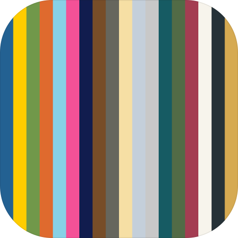
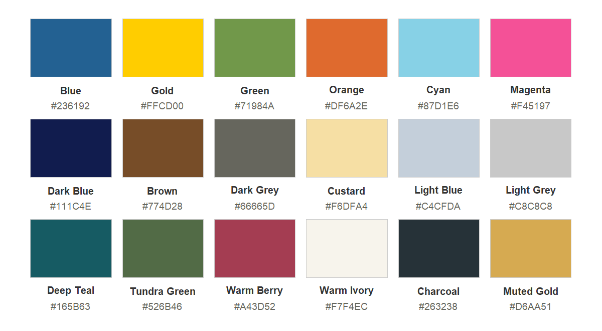

# CANHR Colors 

Brand colors of the Center for Alaska Native Health Research (CANHR) for
**R** and **Stata** graphs.

## R package

Install from GitHub:

```r
# install.packages("devtools")
devtools::install_github("rdazadda/CANHR-color-schemes")
```

Use the colors directly, or through the ggplot2 scales and theme:

```r
library(canhrcolors)
library(ggplot2)

canhrcolors()                    # the full palette
canhrcolors("blue")              # one color
canhrcolors(c("blue", "gold"))   # several colors

ggplot(mpg, aes(displ, hwy, color = drv)) +
  geom_point() +
  scale_color_canhr() +
  theme_canhr()
```

See [Basic Use](https://rdazadda.github.io/CANHR-color-schemes/articles/basicuse.html)
for more examples.

## Stata scheme

Install the scheme, or update an existing installation:

```stata
net install canhr, from("https://raw.githubusercontent.com/rdazadda/CANHR-color-schemes/main/") replace
```

Then use it:

```stata
set scheme canhr

sysuse auto, clear
scatter mpg weight
```

Add `, permanently` to `set scheme` to make it your default. See
[Stata Usage](https://rdazadda.github.io/CANHR-color-schemes/articles/stata.html)
for more examples.

## Colors



| Color        | Hex       | RGB         |
|--------------|-----------|-------------|
| Blue         | `#236192` | 35 97 146   |
| Gold         | `#FFCD00` | 255 205 0   |
| Green        | `#71984A` | 113 152 74  |
| Orange       | `#DF6A2E` | 223 106 46  |
| Cyan         | `#87D1E6` | 135 209 230 |
| Magenta      | `#F45197` | 244 81 151  |
| Dark Blue    | `#111C4E` | 17 28 78    |
| Brown        | `#774D28` | 119 77 40   |
| Dark Grey    | `#66665D` | 102 102 93  |
| Custard      | `#F6DFA4` | 246 223 164 |
| Light Blue   | `#C4CFDA` | 196 207 218 |
| Light Grey   | `#C8C8C8` | 200 200 200 |
| Deep Teal    | `#165B63` | 22 91 99    |
| Tundra Green | `#526B46` | 82 107 70   |
| Warm Berry   | `#A43D52` | 164 61 82   |
| Warm Ivory   | `#F7F4EC` | 247 244 236 |
| Charcoal     | `#263238` | 38 50 56    |
| Muted Gold   | `#D6AA51` | 214 170 81  |

In R, get a color by its name, for example `canhrcolors("deep teal")`. In
Stata, the scheme gives the first fifteen colors to graph series 1 to 15. For
the rest, use the RGB values, for example `color("214 170 81")` for muted
gold.

---

Developed by the Numbers Team at CANHR, the Center for Alaska Native Health
Research.
