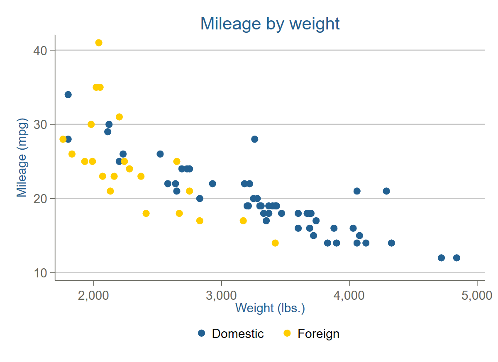
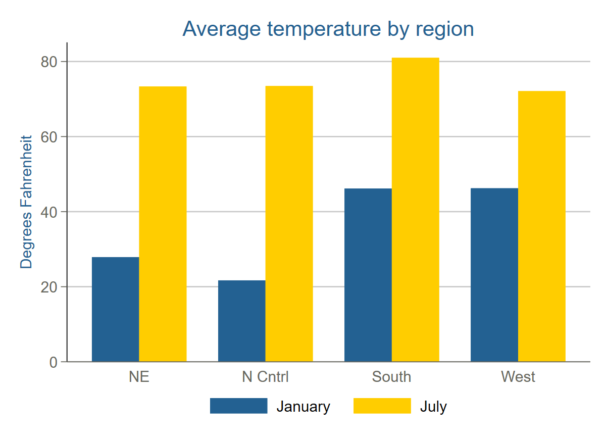
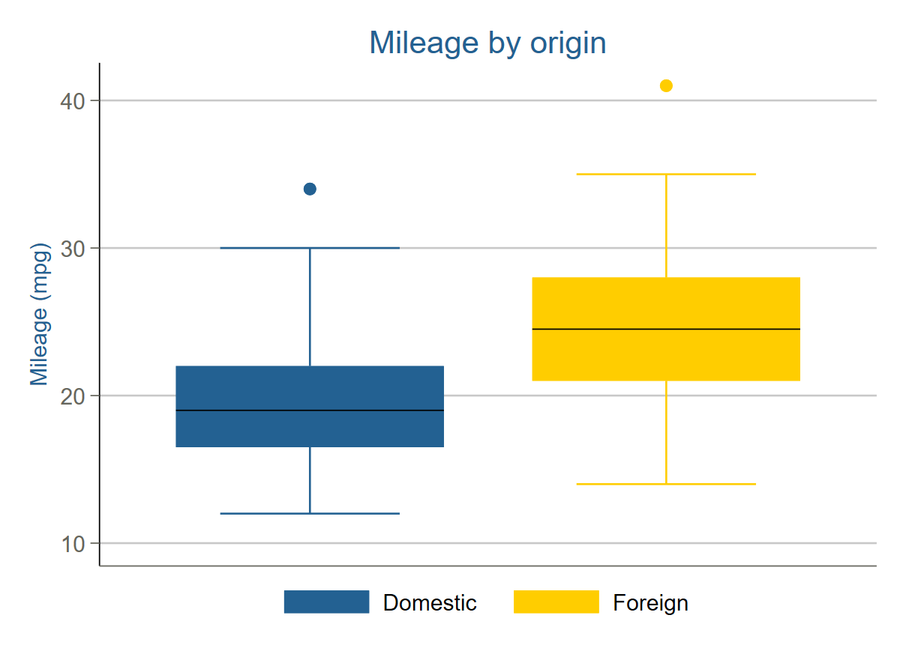
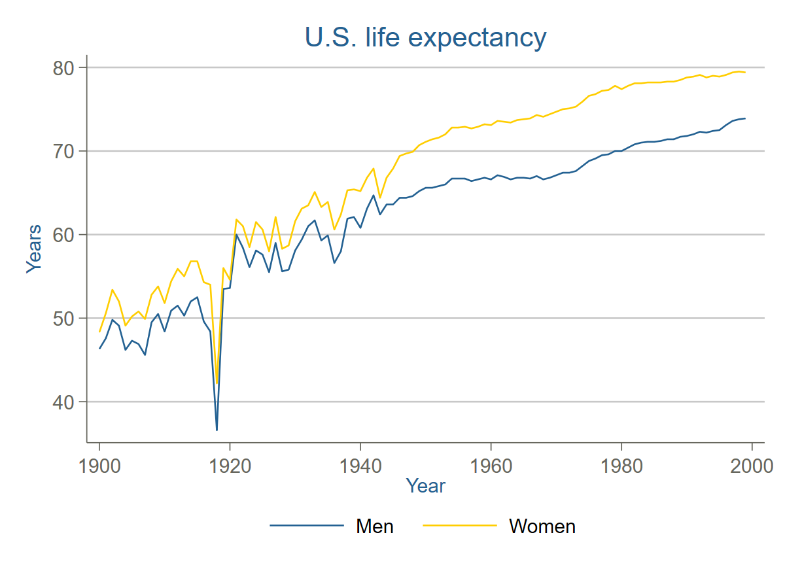

Use the canhr scheme to give Stata graphs the CANHR colors.

## Installation

Install the `canhr` scheme from GitHub:

```stata
net install canhr, from("https://raw.githubusercontent.com/rdazadda/CANHR-color-schemes/main/") replace
```

Running the same command again updates an existing installation.

To install by hand instead, copy `scheme-canhr.scheme` into the `s` folder of
your PLUS directory. Type `sysdir` in Stata to see where that is; on Windows it
is usually `C:\ado\plus\s\`.

## Using the scheme

```stata
set scheme canhr
```

To make it the default for all future sessions:

```stata
set scheme canhr, permanently
```

## Examples

The examples use datasets that come with Stata. The graphs were made with
[`make_stata_graphs.do`](https://github.com/rdazadda/CANHR-color-schemes/blob/main/make_stata_graphs.do).

### Scatter plot

```stata
sysuse auto, clear
twoway (scatter mpg weight if foreign == 0) ///
       (scatter mpg weight if foreign == 1), ///
    title("Mileage by weight") ///
    legend(order(1 "Domestic" 2 "Foreign"))
```



### Bar chart

```stata
sysuse citytemp, clear
graph bar (mean) tempjan tempjuly, over(region) ///
    title("Average temperature by region") ///
    ytitle("Degrees Fahrenheit") ///
    legend(order(1 "January" 2 "July"))
```



### Box plot

`asyvars` gives each group its own color.

```stata
sysuse auto, clear
graph box mpg, over(foreign) asyvars ///
    title("Mileage by origin")
```



### Line graph

```stata
sysuse uslifeexp, clear
twoway line le_male le_female year, ///
    title("U.S. life expectancy") ///
    ytitle("Years") ///
    legend(order(1 "Men" 2 "Women"))
```



## Scheme colors

The scheme gives the first fifteen colors to graph series 1 to 15, in this
order.

| #  | Color        | RGB         | Hex       |
|----|--------------|-------------|-----------|
| 1  | Blue         | 35 97 146   | `#236192` |
| 2  | Gold         | 255 205 0   | `#FFCD00` |
| 3  | Green        | 113 152 74  | `#71984A` |
| 4  | Orange       | 223 106 46  | `#DF6A2E` |
| 5  | Cyan         | 135 209 230 | `#87D1E6` |
| 6  | Magenta      | 244 81 151  | `#F45197` |
| 7  | Dark Blue    | 17 28 78    | `#111C4E` |
| 8  | Brown        | 119 77 40   | `#774D28` |
| 9  | Dark Grey    | 102 102 93  | `#66665D` |
| 10 | Custard      | 246 223 164 | `#F6DFA4` |
| 11 | Light Blue   | 196 207 218 | `#C4CFDA` |
| 12 | Light Grey   | 200 200 200 | `#C8C8C8` |
| 13 | Deep Teal    | 22 91 99    | `#165B63` |
| 14 | Tundra Green | 82 107 70   | `#526B46` |
| 15 | Warm Berry   | 164 61 82   | `#A43D52` |
| 16 | Warm Ivory   | 247 244 236 | `#F7F4EC` |
| 17 | Charcoal     | 38 50 56    | `#263238` |
| 18 | Muted Gold   | 214 170 81  | `#D6AA51` |

Stata has fifteen series styles, so colors after the fifteenth are not given
to series automatically. To use any CANHR color for a single element, give its RGB
value, for example `mcolor("35 97 146")` for blue markers or
`color("214 170 81")` for muted gold.
